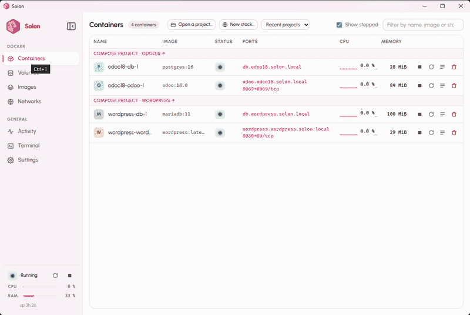
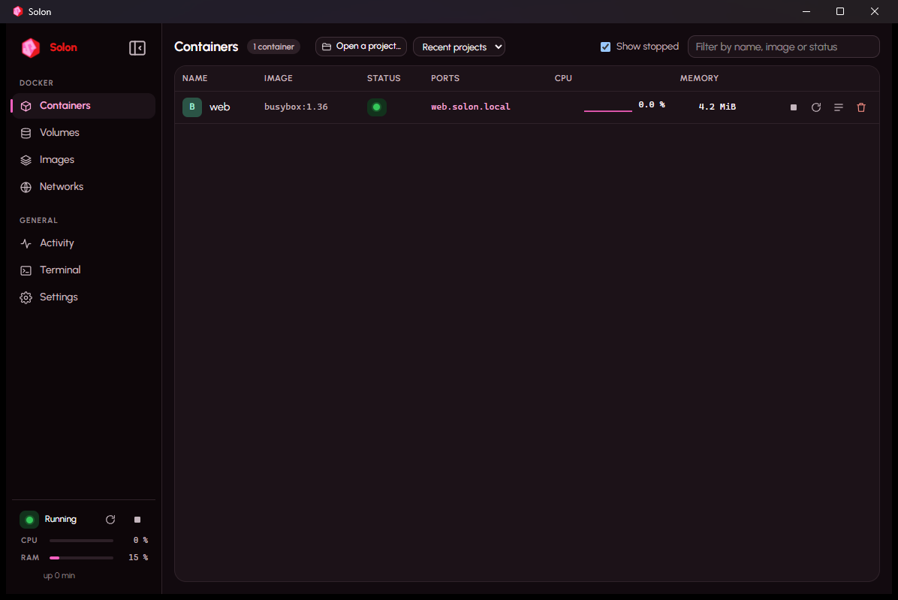

# Solon

*English version: [README.md](README.md).*

[](https://github.com/v94lere/solon/actions/workflows/ci.yml) [](https://github.com/v94lere/solon/releases/latest) [](https://github.com/v94lere/solon/releases) [](LICENSE) [](https://v94lere.github.io/solon/)



*Une pile en un clic : New stack… → n8n → Create and start → le navigateur s'ouvre sur son adresse https://…solon.local.*


**Solon est un gestionnaire de conteneurs autonome pour Windows**, dans l'esprit d'OrbStack : une
installation, aucun prérequis logiciel à installer soi-même, et un moteur Docker complet qui démarre
en quelques secondes dans une machine minuscule et invisible, gérée entièrement par Solon.

Solon **n'est pas** une interface pour un Docker Desktop déjà installé. Il remplace Docker Desktop :
moteur Docker, Compose, images, volumes, réseaux, terminal, journaux, et une icône dans la barre des tâches.

> État du projet (31 octobre 2026) : **0.1.18**, dix-huit versions en deux mois, écrit par une seule
> personne. Solon fait tourner mes propres projets tous les jours, et n'a été testé que sur deux machines :
> un PC Windows 11 Pro et une machine virtuelle Windows 11 Famille neuve. L'installeur n'est **pas encore
> signé** (avertissement SmartScreen ; empreinte SHA-256 publiée avec chaque version). Il reste sûrement des
> aspérités sur du matériel que je n'ai pas :
> [dites-moi ce qui casse chez vous](https://github.com/v94lere/solon/issues/1). Les idées et les
> contributions sont tout aussi bienvenues.



## Ce que Solon fait

- Démarre un moteur Docker (dockerd, containerd, runc, Compose) prêt en **~3 s** après l'ordre de démarrage.
- Expose l'API Docker sur `\\.\pipe\solon` ; les commandes `docker` et `docker compose` livrées avec Solon
  sont déjà dans votre `PATH` et pointent vers Solon, et tout autre CLI Docker fonctionne avec un
  `docker context`.
- Relaie les ports publiés vers `localhost` sans configuration.
- Partage vos dossiers Windows à la demande : `docker run -v C:\...`, `--mount`, projets Compose, exactement
  comme avec Docker Desktop, par **solonfs**, le partage de fichiers de Solon, mesuré 3,6 à 94× plus rapide
  que le partage 9P de WSL2 et de Docker Desktop selon l'opération (`docs/measurements.md`).
- **Import depuis Docker Desktop** : s'il est installé et démarré, Solon liste ses volumes et ses images
  avec leur taille et copie ceux que vous cochez dans son propre moteur. Rien n'est modifié ni supprimé
  du côté de Docker Desktop, et ce qui porte déjà le même nom dans Solon n'est pas touché.
- **Des adresses qui marchent toujours** : chaque conteneur en marche est joignable sur
  `https://<nom>.solon.local` (et `https://<service>.<projet>.solon.local` pour Compose), **qu'il publie un
  port ou non**, avec un certificat reconnu par le navigateur (une autorité de certification locale créée à
  la première utilisation). Les adresses des conteneurs (`10.90.x.y`) sont aussi joignables directement
  depuis Windows.
- **Réveil à la demande** : un conteneur joint via Solon qui ne reçoit plus rien pendant dix minutes est mis
  en pause (zéro processeur, mémoire conservée) ; la requête suivante le réveille en une fraction de seconde
  avant d'être servie. Les bases de données et les tâches de fond qui ne parlent qu'en interne ne sont jamais
  concernées.
- Onglet **Fichiers** pour les conteneurs et les volumes : parcourir, copier vers Windows, envoyer des
  fichiers ou des dossiers (boutons ou glisser-déposer depuis l'Explorateur), créer un dossier, supprimer.
  Fonctionne même quand l'image n'a pas de shell.
- **Debug shell** dans n'importe quel conteneur, y compris les images « distroless » sans shell : une boîte à
  outils (bash, curl, dig, ps, strace, tcpdump, jq, vim…) qui partage les processus, le réseau et les volumes
  du conteneur.
- **Activity** : processeur, mémoire, stockage et réseau du moteur et de chaque conteneur, en direct.
- **Radiographie** : une carte en direct de qui appelle qui dans vos projets, et un journal de chaque
  échange — connexions TCP avec leur issue (un appel refusé apparaît en rouge), échanges HTTP complets pour ce
  qui entre par une adresse `*.solon.local`, noms sur les adresses extérieures. Une barre de lecture pour
  figer, avancer pas à pas, rejouer. Les valeurs sensibles sont masquées avant d'être gardées ; les corps
  sont désactivés par défaut et s'activent par projet.
- **Une commande `solon`** à côté de `docker` : état du moteur et adresses, démarrage et arrêt avec les étapes
  affichées, réglages, sauvegarde et restauration d'un projet, et `solon why`, qui lit la Radiographie et dit
  en français courant pourquoi un appel a échoué. Elle parle au service par son pipe local : aucune demande
  d'administrateur, aucune requête sortante.
- Projets Compose : services, journaux mêlés, Up / Down / Reconstruire avec la sortie en direct, ouverture
  dans l'Explorateur ou VS Code.
- Mémoire au repos (moteur + service) : **430 à 520 Mo** mesurés pour 2 Go alloués ; la mémoire inutilisée
  est rendue à Windows automatiquement.
- **Aucune télémétrie, aucune requête réseau sortante** en dehors de ce que vos conteneurs et vos
  `docker pull` demandent.

## Comparatif : performances, empreinte et fonctionnalités

### Performances : Docker Desktop et Solon

Même machine (Windows 11 Pro, 24 cœurs logiques, NVMe), même pile Compose (une application web Python et sa base PostgreSQL 16,
`bench/compose.yaml`), chaque moteur avec ses réglages par défaut : Docker Desktop 4.66.1 sur WSL2 avec tous les
cœurs et 6,6 Go visibles par les conteneurs ; Solon 0.1.0 avec 22 processeurs et 2 Go. Docker Desktop a été
mesuré le 3 septembre 2026, puis désinstallé de la machine de test ; Solon a été remesuré le 10 septembre 2026
avec le même script. Détails et chiffres bruts : `docs/measurements.md`.

| | Docker Desktop | Solon | |
|---|---|---|---|
| Moteur prêt après l'ordre de démarrage | 6,1 s | **2,6 à 3,4 s** (1,1 s si la machine tourne encore) | 2× plus rapide |
| Mémoire au repos, aucun conteneur | 1 998 Mo | **430 à 520 Mo** | 4× plus léger |
| Mémoire avec l'application web + PostgreSQL, au repos | 5 146 Mo | **1 196 Mo** | 4× plus léger |
| `compose down` puis `up -d`, images présentes | 7,1 s | **5,2 s** | |
| L'application web répond après `up` | 1,5 s | 1,0 à 2,5 s | équivalent |
| Page de connexion de l'application, moyenne de 5 chargements | 27 à 46 ms | 48 à 88 ms | équivalent |
| Initialisation de la base de l'application avec données d'exemple (CPU, surtout mono-thread) | 13,6 s | 12,9 à 13,4 s | équivalent |
| Écritures synchrones sur un volume Docker (`pg_test_fsync`, fdatasync / fsync) | 154 / 79 ops/s | **240 à 290 / 132 à 137 ops/s** | 1,7× plus rapide |
| Dossier Windows monté dans un conteneur, 5 000 fichiers (listage / attributs / lectures / écritures) | 9P | **solonfs** : 6,6× / 94× / 3,6 à 9× / 4× plus rapide | |
| `docker run --rm busybox true`, à chaud | non mesuré | 0,55 s | |

Ce que cela dit, honnêtement : Solon gagne nettement sur ce qui coûte tous les jours (démarrage, mémoire,
partage de fichiers, écritures disque) ; sur le calcul pur les deux moteurs sont équivalents ; la latence web est
identique. Les deux gardent le cache disque de l'invité en mémoire : Solon est plafonné par son allocation (2 Go
par défaut), Docker Desktop est monté à 5 Go.

Pour reproduire : `powershell -ExecutionPolicy Bypass -File bench\bench.ps1` sur le moteur visé par votre
commande `docker` (`-Docker "C:\Program Files\Solon\bin\docker.exe"` pour Solon). Le script ne touche qu'un
projet Compose nommé `solon-bench` sur le port 18069 et le supprime à la fin.

### Empreinte

Solon mesuré le 13 septembre 2026 (0.1.10, trois conteneurs en marche) ; Docker Desktop mesuré sur la même machine
le 3 septembre ; les deux autres d'après leur documentation (marqués *publié*).

| | Solon | Docker Desktop | Podman Desktop | Rancher Desktop |
|---|---|---|---|---|
| Installateur | **102 Mo** | ≈ 600 Mo *(publié)* | ≈ 100 Mo + machine WSL *(publié)* | ≈ 500 Mo *(publié)* |
| Installé sur le disque | **406 Mo** (image Linux 310, CLI `docker` 73, Solon 22) | 6 Go requis *(publié)* | 500 Mo + 2 à 10 Go d'images *(publié)* | non publié |
| Mémoire au repos, aucun conteneur | **430 à 520 Mo** | 1 998 Mo | machine WSL 2, jusqu'à 50 % de la RAM par défaut *(publié)* | moitié des cœurs et de la RAM par défaut *(publié)* |
| Mémoire avec une application web + PostgreSQL | **1 196 Mo** | 5 146 Mo | non mesuré | non mesuré |
| Exige WSL 2 | non (machine Hyper-V propre) | oui (ou ancien moteur Hyper-V) | oui | oui |

### Fonctionnalités comparées

Solon en 0.1.18 ; les autres d'après leur documentation en septembre 2026. « Partiel » : la fonction existe avec une réserve.

| | Solon | Docker Desktop | Podman Desktop | Rancher Desktop |
|---|---|---|---|---|
| CLI `docker` et Compose officiels, sans alias | oui | oui | partiel : socket compatible, quelques différences | oui (moby) |
| Fonctionne sans WSL 2 | oui | partiel : ancien moteur Hyper-V | non | non |
| Windows Famille | oui (Plateforme de machine virtuelle) | oui (WSL 2) | oui | oui |
| `https://<service>.<projet>.solon.local` pour chaque conteneur, certificat local reconnu | oui | non | non | non |
| Page Projets : adresse, environnement, ports vérifiés avant Up, journaux filtrés | oui | partiel : liste Compose | partiel : liste Compose | non |
| Un environnement par branche Git, volumes copiés | oui | non | non | non |
| Sauvegarde et restauration d'un projet, volumes compris | oui | partiel : extension tierce | non | non |
| Ligne de commande pour le moteur lui-même : état, démarrage et arrêt, réglages, sauvegarde, pourquoi un appel a échoué | oui (`solon`) | partiel : `docker desktop start/stop/status` *(documenté)* | partiel : `podman machine` *(documenté)* | partiel : `rdctl` *(documenté)* |
| Conteneurs inactifs mis en veille, réveil à la demande | oui | partiel : Resource Saver met toute la machine en pause | non | non |
| Dossiers Windows partagés par solonfs (3,6 à 94× plus rapide que 9P selon l'opération) | oui | non : 9P via WSL 2 | non : 9P | non : 9P |
| Recherche des projets Compose sur le disque (7 s sur 928 Go) | oui | non | non | non |
| Projets relancés après un redémarrage de Windows ou une mise à jour | oui | partiel : politique `restart` de Docker | partiel | partiel |
| VS Code Dev Containers | oui, vérifié | oui | partiel : réglage du chemin docker | oui |
| Kubernetes intégré | non | oui | partiel : extensions Kind / Minikube | oui (K3s) |
| Conteneurs Windows | non | oui | non | non |
| Place de marché d'extensions | non | oui | oui | non |
| Gratuit en entreprise | oui (Apache 2.0) | payant au-delà de 250 salariés ou 10 M$ de CA | oui (Apache 2.0) | oui (Apache 2.0) |
| Installateur signé | pas encore | oui | oui | oui |

## Prérequis

| Prérequis | Détail |
|---|---|
| Windows | **Windows 11 ou Windows 10 22H2, toutes éditions, Famille comprise.** Pro, Entreprise et Éducation utilisent Hyper-V ; Famille utilise la Plateforme de machine virtuelle, que l'installateur active (un redémarrage). Vérifié sur Windows 11 Famille 25H2. Sur Famille, le repli de partage de fichiers 9P n'est pas disponible ; le partage par défaut fonctionne. |
| Processeur | Virtualisation matérielle **activée dans le BIOS/UEFI** : Intel VT-x (souvent « Intel Virtualization Technology ») ou AMD-V (« SVM Mode »). |
| Mémoire | 8 Go recommandés (4 Go minimum). Solon alloue 2 Go au moteur par défaut, ajustable dans les réglages. |
| Disque | ~400 Mo pour Solon et son image Linux, plus un disque de données dynamique (64 Go maximum par défaut, occupé à la demande). |
| Composants Windows | « Hyper-V » et « Plateforme de machine virtuelle ». L'installeur les active ; un redémarrage peut être demandé. |

Solon cohabite avec WSL2 et Docker Desktop : il n'utilise ni leur pipe, ni leurs réseaux, ni leur
contexte `docker` par défaut.

## Installation

### Installeur

Téléchargez `Solon_<version>_x64-setup.exe` depuis les [releases](https://github.com/v94lere/solon/releases)
et vérifiez son empreinte SHA-256 avec la valeur publiée avec la version. L'installeur demande l'élévation une
fois, puis : active les composants Windows nécessaires (un redémarrage peut être demandé), installe le service
`SolonService`, copie l'image Linux et les commandes `docker` et `solon`, et crée le raccourci. Installation silencieuse :
`Solon_<version>_x64-setup.exe /S`.

L'installeur **n'est pas encore signé** : SmartScreen affiche « Windows a protégé votre ordinateur » ; cliquez
« Informations complémentaires » puis « Exécuter quand même ». La chaîne de signature est prête
(`installer/sign.ps1`, `tauri.signed.conf.json`) et s'activera dès qu'un certificat sera disponible.

Désinstallation : Paramètres → Applications → Solon. Le désinstalleur arrête le moteur, retire le service et
**demande** avant de supprimer vos images et volumes (`%ProgramData%\Solon`) ; par défaut ils sont conservés.

### Depuis les sources (développeurs)

Prérequis : Rust stable (≥ 1.85), Node 22, et **Solon lui-même** installé (l'image Linux du moteur se construit
dans un conteneur Solon : pas besoin de WSL). Une session Windows **administrateur** sert seulement au mode console.

```powershell
# 1. Agent invité (compilation croisée depuis Windows, sans chaîne C)
rustup target add x86_64-unknown-linux-musl
cargo build -p solon-agent --release --target x86_64-unknown-linux-musl

# 2. Image Linux (noyau réutilisé + système racine Alpine + initrd), construite dans un conteneur Solon (~15 s)
docker run --rm -v "${PWD}:/work" -w /work public.ecr.aws/docker/library/alpine:3.24 sh -c "apk add -q bash curl python3 e2fsprogs coreutils tar grep findutils gzip; SKIP_KERNEL=1 SOLON_IMAGE_VERSION=0.1.0-dev.N bash image/build.sh /work/target/x86_64-unknown-linux-musl/release/solon-agent"
#    (le noyau lui-même se compile une fois avec image/kernel/build-kernel.sh, ~7 min, dans le même genre de conteneur)

# 3. Service, commande `solon` et application (l'installeur embarque image/out/<version>, voir tauri.conf.json)
cargo build --release -p solon-service -p solon-cli
cd apps\desktop && npm install && npm run tauri build
#    (le service et le CLI sont copiés comme ressources : `tauri build` ne les reconstruit pas, d'où l'ordre)
```

Mode développement sans installer : le service se lance en mode console, à la main
(`solon-service.exe console --start` dans un terminal administrateur) ou par le script ci-dessous (une
fenêtre UAC), puis l'application en mode dev :

```powershell
.\tests\e2e\start-console.ps1 -ImageDir .\image\out\<version> -Release
cd apps\desktop; npm run tauri dev
```

## Utilisation

Le bloc en bas du menu montre l'état du moteur, son temps de fonctionnement et deux mini-jauges (processeur, mémoire).
L'icône de la barre des tâches porte un point vert, orange, rouge ou gris selon l'état. La taille et la position de la
fenêtre sont mémorisées.

Le menu de gauche a deux parties : **Docker** (Projects, Containers, Volumes, Images, Networks) et **General** (Activity,
Radiography, Terminal, Settings). Le bouton en haut du menu (ou `Ctrl+B`) le replie en icônes seules ; le choix est mémorisé.

- **Projets** (accueil) : une carte par projet Compose avec son état, son **adresse principale**
  (`https://web.blog.solon.local`, copiable, avec le cadenas), ses services, Ouvrir / Up / Arrêter / Détails. Les dossiers ouverts auparavant mais arrêtés sont listés aussi ; les
  conteneurs lancés hors projet sont dans « Autres conteneurs ». Sans rien encore, la page propose quatre
  départs : ouvrir un dossier, choisir une pile, chercher les projets déjà présents sur ce PC, essayer
  hello-world. La page d'un projet gagne un onglet
  **Environnement** : le `.env` et les blocs `environment:` du `compose.yaml`, plus les ports publiés,
  modifiables sans toucher au YAML.
- **Sauvegarder et restaurer un projet** : « Sauvegarder… » sur la page d'un projet écrit un seul zip avec les
  fichiers Compose, le `.env` et les données de chaque volume (prises directement dans le moteur, projet en
  marche ou non) ; « Restaurer une sauvegarde… » sur l'accueil Projets recrée volumes et fichiers dans le
  dossier de votre choix, puis Up.
- **Ports vérifiés avant Up** : un port hôte déjà pris sur ce PC arrête Up avant tout démarrage, avec
  « Utiliser 8081 au lieu de 8080 » (le fichier est modifié pour vous) ou « Up quand même ».
- **Chercher les projets sur ce PC** : un clic lit la table des fichiers des disques internes (quelques
  secondes, droits administrateur du service, rien ne quitte le PC) et liste chaque dossier avec un
  `compose.yaml`, un `Dockerfile` ou un `devcontainer.json`, hors dossiers de dépendances, de cache et
  système. On coche ceux à garder.
- **Un environnement par branche Git** : sur un projet dont le dossier est un dépôt Git, cochez « Un
  environnement par branche » à côté du nom de la branche. Chaque branche a alors ses conteneurs, ses volumes
  et ses adresses (`web.blog-feature-login.solon.local`). Changez de branche dans votre terminal : Solon propose
  d'arrêter l'ancien environnement et de démarrer le nouveau, avec ou sans copie des données de l'ancienne branche.
- **Relance de ce qui tournait** : quand le moteur s'arrête (redémarrage de Windows, installation, Stop depuis
  Solon), Solon retient les projets et conteneurs en marche et les redémarre une fois le moteur revenu ; Docker
  seul ne le fait que pour les conteneurs `restart: always`. Réglages → moteur, activé par défaut.
- **Conteneurs** : liste temps réel avec CPU et mémoire, filtre, groupes Compose, actions en icônes, journaux en
  flux, terminal, inspection. Un **port publié est un lien** vers `http://localhost:<port>`, le domaine local aussi.
  Les **projets Compose** vivent ici : « Ouvrir un projet… » choisit un dossier contenant `compose.yaml`, la liste
  déroulante rappelle les projets récents, et un clic sur l'en-tête d'un groupe Compose ouvre l'écran du projet :
  services et leur état, **journaux de tous les services mêlés**, Up / Down / Reconstruire avec la **sortie en
  direct**, ouverture du dossier dans l'**Explorateur** ou dans **VS Code**.
- **Réveil à la demande** : un conteneur joint via Solon (adresse `solon.local` ou port publié) qui ne reçoit plus
  rien pendant dix minutes (réglable) est **mis en pause** : zéro processeur, mémoire conservée. La première requête
  suivante le réveille en une fraction de seconde, avant d'être servie. Les bases de données et les tâches de fond
  qui ne parlent qu'en interne ne sont jamais concernées ; un bouton « Keep awake » dans la fiche exclut un
  conteneur ; l'état « Asleep » apparaît dans la liste.
- **Piles prêtes et détection de projet** : « New stack… » ouvre une galerie : des kits de
  démarrage qui génèrent un projet au premier lancement (Django + PostgreSQL, Flask + Redis, FastAPI +
  PostgreSQL, Next.js), des applications prêtes (WordPress, Odoo 18, PostgreSQL, MariaDB, MongoDB, Redis, n8n,
  Nextcloud, Ghost, Gitea, Uptime Kuma, Jupyter Lab, site statique Nginx) et des outils de développement (Mailpit) : on
  choisit, on désigne un dossier, on relit le `compose.yaml` généré, « Créer et démarrer ». Ouvrir un dossier sans fichier
  Compose fait regarder à Solon ce qu'il contient (package.json, requirements.txt, Dockerfile, composer.json,
  go.mod, Cargo.toml, pom.xml, .csproj, Gemfile…) et proposer un environnement, modifiable
  avant création. Rien n'est jamais écrasé.
- **Fiche d'un conteneur** (clic sur son nom) : onglet **Overview** avec image, commande, dates, politique de
  redémarrage, réseaux (adresse, passerelle, alias), ports, montages, variables d'environnement, étiquettes, et
  **copie de fichiers** dans les deux sens (`docker cp` sans ligne de commande). Onglets Logs (filtres Tout /
  Avertissements / Erreurs avec compteurs, recherche, retour à la ligne, couleurs), Files, Terminal, Debug shell,
  Inspect. Démarrer, arrêter, redémarrer, supprimer et « Keep awake » dans l'en-tête.
- **Fichiers** (onglet de la fiche d'un conteneur, et bouton « Files » ou clic sur le nom d'un volume) : un
  explorateur des fichiers du conteneur ou du volume : parcourir, copier vers Windows, envoyer des fichiers ou un
  dossier (bouton ou **glisser-déposer** depuis l'Explorateur), créer un dossier, supprimer. Fonctionne sans shell
  dans l'image ; les conteneurs doivent être en marche pour être parcourus, les volumes toujours.
- **Debug shell** (onglet de la fiche) : un shell d'outils (bash, curl, dig, ps, strace, tcpdump, jq, vim…) qui
  partage les processus, le réseau et les volumes du conteneur **même si son image n'a aucun shell** (images
  « distroless », Go, .NET). Le système de fichiers du conteneur est visible sous `/proc/1/root`. Rien n'est
  modifié dans le conteneur ; la boîte à outils (`solon-debug`) se construit au premier usage.
- **Images, Volumes, Réseaux** : liste, création, inspection, suppression (toujours avec confirmation).
- **Des adresses qui marchent, toujours** : chaque conteneur en marche est joignable sur
  `https://<nom>.solon.local` (et `https://<service>.<projet>.solon.local` pour Compose), **qu'il publie un port
  ou non**. Solon lit le port que l'image expose (80, 8080, 3000, 8069…), tient à jour un bloc dans le fichier
  `hosts` de Windows, et route les requêtes depuis `127.0.0.1:80` (HTTP) et `127.0.0.1:443` (HTTPS) d'après le nom
  demandé. Le HTTPS repose sur une autorité de certification locale « Solon Local CA », créée à la première
  utilisation et installée dans le magasin racine de la machine : le navigateur n'affiche aucun avertissement.
  Les **adresses des conteneurs** (`10.90.x.y`) sont aussi joignables directement depuis Windows (`curl
  http://10.90.0.2/`, un client PostgreSQL vers `10.90.1.2:5432`…). Si un autre logiciel occupe le port 80 ou
  443, la partie correspondante est désactivée et les ports publiés restent utilisables. `curl.exe` de Windows
  refuse les certificats sans point de révocation : ajouter `--ssl-no-revoke` (comme avec mkcert).
- **Notifications Windows** : conteneur arrêté avec une erreur (hors actions faites dans Solon), moteur en échec
  ou en redémarrage, disque du moteur plein à 90 %.
- **Diagnostic** (Réglages → Exporter un diagnostic) : une archive zip avec les journaux, l'état, les réglages,
  les prérequis et `docker info`, à joindre à un rapport de bug. Aucun identifiant n'y figure.
- **Activity** : performances en temps réel. En haut, le moteur : processeur, mémoire (utilisée / totale, réservée),
  stockage des données, réseau, avec les courbes sur 1 min, 10 min ou 1 h au choix. En dessous, chaque conteneur en marche :
  processeur, mémoire, débit réseau, courbe du processeur ; colonnes triables. Rien n'est installé dans les conteneurs.
- **Radiography** (`Ctrl+7`) : qui appelle qui, en temps réel. Une carte (un cercle par service, un trait par
  relation, rouge quand des appels échouent) et un journal (un échange par ligne, dépliable pour voir les
  en-têtes). Ce qui entre par une adresse `*.solon.local` est montré comme l'échange HTTP complet ; les appels
  entre conteneurs montrent la connexion et son issue ; les adresses extérieures portent le nom qui a été
  résolu. La barre de lecture fige, passe d'un échange à l'autre et rejoue à ×0,25, ×1 ou ×4. « Capturer les
  corps », par projet, garde les 4 premiers Ko des corps texte. En-têtes, paramètres d'URL, champs de
  formulaire et clés JSON au nom sensible, courriels et téléphones sont masqués à la capture. Tout reste sur
  votre PC.
- **Terminal** (section, ou `Ctrl+\``) : un shell root dans le moteur Linux lui-même, pour `docker`, `ps`, `df`,
  `dmesg`… La session reste ouverte quand on change de section ; « Nouvelle session » en relance une.
- **Recherche globale `Ctrl+K`** : conteneurs, images, volumes, réseaux, projets, actions du moteur, sections.
  `Ctrl+1` à `Ctrl+9` changent de section dans l'ordre du menu.
- **Réglages** : langue (anglais par défaut, français), apparence (clair, sombre, Windows), couleur d'accent (rose
  Solon ou couleur de Windows), mémoire et processeurs du moteur (par défaut tous les cœurs moins deux), limite
  de stockage, démarrage à l'ouverture de session, mise en veille des conteneurs inactifs, repli sur l'ancien
  partage de fichiers, export de diagnostic.
- **Barre des tâches** : un clic sur l'icône ouvre le menu : état du moteur, nombre de conteneurs en marche,
  **chaque projet avec Démarrer / Redémarrer / Arrêter**, puis les conteneurs hors projet, ouvrir Solon,
  démarrer ou arrêter le moteur, quitter. Dans la langue de l'interface. Fermer la fenêtre laisse Solon actif
  dans la barre des tâches.

### CLI `docker` et `docker compose` intégrés

L'installeur place `C:\Program Files\Solon\bin` en tête du PATH. Il contient le **CLI Docker officiel** et le
**plugin Compose** (Apache-2.0, versions dans `bin\NOTICE-third-party.txt`), derrière un petit lanceur `docker.exe`
qui les dirige vers le moteur Solon. Dans un **nouveau** terminal :

```powershell
docker version
docker compose -f examples\wordpress\compose.yaml up -d
```

Le lanceur respecte vos choix : `-H`, `--context`, `DOCKER_HOST` ou `DOCKER_CONTEXT` l'emportent, donc Docker
Desktop reste joignable si vous le gardez (`docker context use desktop-linux`).

Avec un CLI `docker` déjà installé (Docker Desktop, winget) :

```powershell
docker context create solon --docker host=npipe:////./pipe/solon
docker context use solon
```

> Si Docker Desktop est installé, le CLI utilise le gestionnaire d'identifiants Windows et peut envoyer
> des identifiants Docker Hub périmés (« unauthorized: incorrect username or password »). Faites
> `docker logout` ou utilisez un `DOCKER_CONFIG` vide pour le vérifier ; ce n'est pas lié à Solon.

### Ligne de commande : `solon`

Le même dossier contient `solon`, la commande propre à Solon. `docker` parle aux conteneurs ; `solon` parle au
moteur qui les entoure : son état, ses adresses, ses réglages, la Radiographie, les sauvegardes. Elle passe par
le pipe local du service, comme l'application : aucune demande d'administrateur, aucune requête sortante. Les
messages sont en anglais, ou en français quand Windows l'est (`SOLON_LANG=fr` force). `solon help` liste toutes
les commandes ; `--json` sur `status`, `projects`, `domains`, `trace`, `settings`, `prereq` et `watch` donne une
sortie lisible par un programme. Codes de sortie : 0, 1 erreur, 2 usage, 3 service injoignable.

`solon` seul vaut `solon status`. Les sorties ci-dessous sont abrégées :

```text
> solon
Solon 0.1.17 · moteur prêt depuis 09:12:04 (2 h 31 min)
  image 0.1.0-dev.22 · adresse 172.30.0.2
  domaines locaux *.solon.local : http et https

2 conteneurs en marche, 1 endormis (réveil à la demande)
CONTENEUR              PROJET     ÉTAT        ADRESSE
wordpress-db-1         wordpress  Up 2 hours  https://db.wordpress.solon.local
wordpress-wordpress-1  wordpress  endormi     https://wordpress.wordpress.solon.local

> solon restart
Redémarrage du moteur…
  vérification des prérequis…
  nettoyage…
  vérification de l'image…
  préparation du disque de données…
  création du réseau…
  création du moteur…
  amorçage…
  attente du moteur…
  configuration du réseau…
  attente de Docker…
Moteur prêt.

> solon projects
PROJET     ÉTAT        DOSSIER                    ADRESSES
wordpress  running(2)  C:\Users\moi\wordpress     db.wordpress.solon.local, wordpress.wordpress.solon.local

> solon why wordpress
Depuis 01:27:40, … Ce qui ressort :

- 10.90.5.4 a essayé 4 fois de joindre db (wordpress) sur le port 9999 sans jamais obtenir de réponse (la
  dernière à 01:28:51, depuis le programme « wget »). Rien n'écoutait là. Le conteneur est-il démarré, et
  écoute-t-il bien ce port ? `docker logs` dessus dit en général pourquoi.

Le détail : solon trace wordpress

> solon trace wordpress -n 3
01:28:25  wordpress (wordpress) -> db (wordpress):3306  fermée après 48 ms  [apache2]
01:28:25  GET https://wordpress.wordpress.solon.local/wp-login.php  -> 302 en 170 ms  (wordpress (wordpress))
01:28:51  10.90.5.4 -> db (wordpress):9999  ÉCHEC, pas de réponse  [wget]

> solon backup C:\Users\moi\wordpress
Sauvegarde de wordpress (C:\Users\moi\wordpress)…
Écrit : wordpress-20261031-1422.zip (2 volumes, …)

> solon settings memory=4096 idle=20
Enregistré.
Mémoire, processeurs, disque et partage de fichiers s'appliquent au prochain démarrage du moteur : solon restart
```

`solon why` lit le même historique que l'écran Radiographie et regroupe ce qui a mal tourné : les appels
refusés par appelant, destination et port, avec un conseil (conteneur endormi, rien n'écoute, adresse hors du
moteur), les erreurs de serveur (5xx) par hôte, les refus 401/403, la requête la plus lente quand elle dépasse
une seconde. Quand rien ne ressort, il le dit, avec les comptes. `solon trace` est le journal (`-f` suit le
direct, `--all` imprime tout), `solon clear [projet]` l'oublie.

`solon backup` et `solon restore` font exactement ce que font les boutons de l'application : un zip avec le
fichier Compose, le `.env` et les volumes, restauré dans le dossier de votre choix. `solon domains` liste
toutes les adresses `*.solon.local` qui répondent en ce moment ; `solon exec` lance une commande en root dans le
moteur ; `solon logs` et `solon diag` donnent le journal du service et le zip à joindre à un signalement ;
`solon watch` affiche les événements du moteur au fil de l'eau ; `solon prereq` vérifie les prérequis Windows ;
`solon settings` seul montre chaque réglage avec sa signification.

### VS Code Dev Containers

L'extension **Dev Containers** fonctionne avec Solon telle quelle : elle utilise le `docker` de votre PATH,
qui est celui de Solon. Ouvrez un dossier qui contient `.devcontainer/devcontainer.json`, lancez « Dev Containers :
Rouvrir dans un conteneur », et VS Code construit ou tire l'image, démarre le conteneur avec le dossier monté
dans `/workspaces/<nom>`, installe son serveur dedans et s'y connecte. Les ports transmis fonctionnent, le
`postCreateCommand` s'exécute, et le conteneur apparaît dans la liste des conteneurs de Solon (et dans
« Chercher les projets sur ce PC »). Rien à configurer ; si vous aviez réglé `dev.containers.dockerPath` pour
Docker Desktop, retirez-le. Testé avec `@devcontainers/cli` 0.89 et l'image
`mcr.microsoft.com/devcontainers/base:alpine`.

La vue **Conteneurs** (extension `ms-azuretools.vscode-containers`) se rafraîchit en direct grâce à
`docker events`. L'extension arme cette écoute une fois, au démarrage, et renonce après trois échecs
immédiats. Le pipe Docker de Solon existe dès le lancement du service Solon et `docker` attend pendant que le
moteur démarre : une fenêtre VS Code restaurée à l'ouverture de session garde le rafraîchissement en direct.
Si Solon est mis à jour pendant que VS Code est ouvert, le pipe disparaît quelques secondes et cette fenêtre
retombe sur un rafraîchissement par minute et le bouton Actualiser : lancez *Developer: Reload Window* pour
retrouver le direct.

## Dossiers Windows partagés : comment ça marche

Les dossiers Windows montés dans les conteneurs (`-v C:\...`, projets Compose) passent par **solonfs**, le système de
fichiers de Solon : un serveur côté Windows, un client côté Linux, et un protocole qui ramène tout un dossier en une
seule question au lieu d'une par fichier. Mesuré sur 5 000 fichiers face au partage 9P de Windows (celui de WSL2 et
de Docker Desktop) : 3,6 à 94× plus rapide selon l'opération (lister 6,6×, lire les attributs 94×, lire le contenu
3,6 à 9×, écrire 4×). Détails et méthode : `docs/measurements.md`.

Ce qu'il faut savoir :

- Les fichiers apparaissent comme appartenant à `root` en `0777` / `0666` ; `chmod` et `chown` sont acceptés et
  ignorés (Windows n'a pas de droits POSIX), comme avec Docker Desktop.
- Un changement fait côté Windows est vu dans le conteneur au plus 1,5 s plus tard.
- Pour les dépendances et les bases de données, préférez toujours des **volumes Docker** : ils vivent sur le disque de
  Solon, à vitesse native (20 à 50 ms pour les mêmes 5 000 fichiers).
- Repli : Réglages → « Utiliser l'ancien partage de fichiers Windows (9P) » remet l'ancien mécanisme au prochain
  démarrage du moteur. L'ancien partage reste aussi monté en secours sous `/mnt/host9p/<lettre>` dans la machine.

## Dépannage

Guide pas à pas des problèmes les plus fréquents (SmartScreen, redémarrage après l'activation d'Hyper-V, port
déjà pris, conteneur qui se termine aussitôt, réseau et adresses `solon.local`, espace disque) :
**<https://v94lere.github.io/solon/fr/depannage/>**. Pour signaler un problème, joignez le zip de
Réglages → Diagnostic → « Exporter un diagnostic… » (journaux, état, réglages, `docker info` ; aucun identifiant).

Les messages de l'interface portent un **code stable** ; les journaux sont dans
`%ProgramData%\Solon\logs` (service) et se copient depuis l'écran d'erreur.

| Code | Cause | Que faire |
|---|---|---|
| `VIRTUALIZATION_DISABLED_IN_FIRMWARE` | VT-x / AMD-V désactivé | Activer la virtualisation dans le BIOS/UEFI (onglet Advanced, CPU ou Security), redémarrer. |
| `WINDOWS_FEATURE_MISSING` | Hyper-V ou Plateforme de machine virtuelle désactivés | Réinstaller Solon (l'installeur les active) ou, en PowerShell administrateur : `Enable-WindowsOptionalFeature -Online -FeatureName Microsoft-Hyper-V,VirtualMachinePlatform -All`, puis redémarrer. |
| `WINDOWS_FEATURE_BLOCKED_BY_POLICY` | Stratégie d'entreprise (WSUS, GPO) refuse l'activation | Demander à l'administrateur d'activer `Microsoft-Hyper-V` et `VirtualMachinePlatform`. |
| `HYPERVISOR_NOT_RUNNING` | Hyperviseur Windows non démarré | Désinstaller les anciens VirtualBox/VMware (< 6.1 / < 15.5), vérifier `bcdedit /enum` (`hypervisorlaunchtype Auto`), ne pas exécuter Solon dans une VM sans virtualisation imbriquée. |
| `HOST_COMPUTE_SERVICE_UNAVAILABLE` | Service `vmcompute` ou `hns` arrêté ou absent | Redémarrer Windows ; sinon réinstaller Solon. |
| `BLOCKED_BY_SECURITY_SOFTWARE` | Antivirus / EDR bloque les disques ou le service | Ajouter `%ProgramData%\Solon` et le dossier d'installation aux exclusions. |
| `INSUFFICIENT_PRIVILEGES` | Le service ne tourne pas avec les droits attendus | Réinstaller Solon (le service doit tourner en LocalSystem). |
| `IMAGE_CORRUPTED` | Fichiers du moteur absents ou empreinte SHA-256 invalide | Réinstaller Solon. |
| `DATA_DISK_ERROR` | `data.vhdx` impossible à créer ou ouvrir | Vérifier l'espace disque et les exclusions antivirus ; en dernier recours renommer `%ProgramData%\Solon\data.vhdx` (perte des données Docker). |
| `VM_BOOT_TIMEOUT`, `AGENT_UNREACHABLE`, `ENGINE_UNREACHABLE` | La machine ne répond pas | Redémarrer le moteur ; consulter `solon-service.log` ; signaler avec le journal. |
| `UNSUPPORTED_WINDOWS_EDITION` | Édition de Windows non prise en charge | Solon fonctionne sur Windows 10 22H2 et Windows 11, toutes éditions, Famille comprise ; les versions plus anciennes ne sont pas prises en charge. Mettre Windows à jour. |
| `VM_CONFIGURATION_REJECTED`, `HCS_ERROR` | Windows a refusé la configuration du moteur, ou la couche de virtualisation a renvoyé une erreur | Redémarrer une fois ; si cela persiste, signaler avec `solon-service.log` (il contient le code d'erreur Windows). |
| `IO` | Un fichier sous `%ProgramData%\Solon` n'a pas pu être lu ou écrit | Vérifier l'espace disque et les exclusions antivirus sur `%ProgramData%\Solon`. |
| `INTERNAL` | Un bogue de Solon | Signaler avec `solon-service.log` ; le moteur repart en général après un redémarrage. |
| Pas d'accès réseau depuis les conteneurs | VPN d'entreprise ou conflit de plage IP | Solon choisit une plage libre parmi `172.30.0.0/24`… et fixe le MTU à 1400 ; certains VPN (AnyConnect, GlobalProtect) bloquent tout de même le trafic des cartes virtuelles : désactiver le VPN pour tester, puis signaler. |
| « Le service Solon n'est pas en cours d'exécution » | Service arrêté | `sc start SolonService` en administrateur, ou réinstaller. |

Coupure de courant ou arrêt brutal : au démarrage suivant, Solon vérifie et répare le disque de données
(`fsck`), puis redémarre le moteur. Les écritures non synchronisées des deux dernières secondes peuvent être
perdues, comme sur toute machine Linux.

## Limites connues (version 0.1)

- **Ports UDP** publiés non relayés vers `localhost` (TCP seulement).
- **Un seul moteur par machine**, pas de profils multiples.
- **Installeur non signé** (avertissement SmartScreen). **Pas de mise à jour silencieuse** : Solon signale
  qu'une nouvelle version existe (Réglages → Mises à jour, une requête vers github.com, désactivable).
  « Installer la mise à jour » télécharge l'installateur, vérifie son SHA-256 avec le `SHA256SUMS.txt` de la
  version, puis Windows demande l'autorisation ; Solon se rouvre et relance ce qui tournait. Rien ne
  s'installe sans vous.
- Un conteneur endormi n'exécute pas ses tâches planifiées internes tant que rien ne l'appelle ; « Keep
  awake » sur sa fiche si cela compte.
- `curl.exe` de Windows refuse les certificats HTTPS locaux sans `--ssl-no-revoke` (comme avec mkcert) ; les
  navigateurs et .NET les acceptent.

## Où ça va, et où vous pouvez aider

Solon est jeune, et la liste de ce qui reste à faire est plus longue que celle de ce qui est fait. Voici les
prochains chantiers, chacun avec une issue où commenter ou se lancer :

- **Mettre à jour les images depuis l'application** ([#3](https://github.com/v94lere/solon/issues/3)) : une
  pastille quand une version plus récente existe, un bouton pour la tirer et recréer les conteneurs.
- **Relayer les ports UDP publiés** ([#5](https://github.com/v94lere/solon/issues/5)), le dernier écart face à
  `docker run -p`.
- **Rechargement à chaud depuis Windows** ([#7](https://github.com/v94lere/solon/issues/7)) : prévenir le
  conteneur qu'un fichier Windows a changé, pour que Vite, nodemon et le rechargeur d'Odoo le voient.
- **Windows 10**, testé et non supposé.
- **Un installateur signé** : le sponsor de certificat demande d'abord de la notoriété, donc celui-ci dépend
  des gens qui trouveront le projet utile.

Pour commencer, les issues marquées [good first issue](https://github.com/v94lere/solon/labels/good%20first%20issue)
et [help wanted](https://github.com/v94lere/solon/labels/help%20wanted). `CONTRIBUTING.md` compile le tout en
une commande, et la documentation, les traductions et les reproductions de bogues comptent autant que le code.

## Documentation

- `ARCHITECTURE.md` : choix techniques (virtualisation HCS, image Linux, HvSocket, solonfs, réseau), résultats
  mesurés bloc par bloc, registre des risques.
- `docs/guide-fonctionnel.md` : le guide fonctionnel de l'application, écran par écran.
- `docs/measurements.md` : toutes les mesures et les faits établis.
- `bench/` : le script de comparaison et sa pile Compose (voir le comparatif plus haut).
- `site/` : le site de présentation (Astro, statique), publié sur GitHub Pages par le workflow « Site ».
- `tests/e2e/` : scénarios de bout en bout.
- `CONTRIBUTING.md` : comment contribuer ; `SECURITY.md` : comment signaler une faille ;
  `CODE_OF_CONDUCT.md`.

## Licence

Apache 2.0, voir `LICENSE` et `NOTICE`. Solon embarque des logiciels tiers (CLI Docker, Docker Compose, un noyau
Linux, des paquets Alpine, des dépendances Rust et npm, la police Urbanist) sous leurs propres licences : voir
`THIRD-PARTY.md`. Pour contribuer : `CONTRIBUTING.md` ; pour signaler une faille : `SECURITY.md`.
